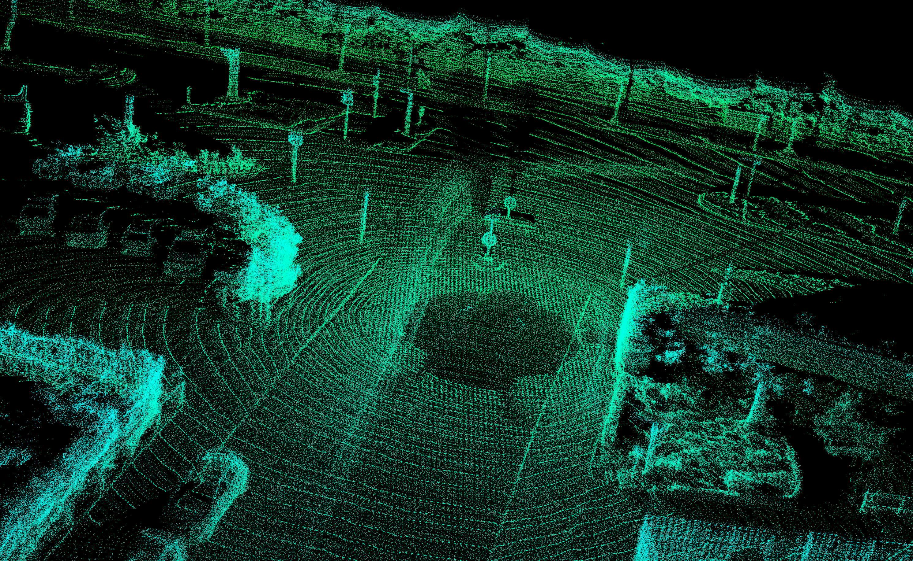
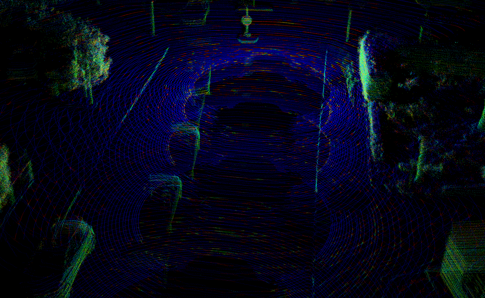
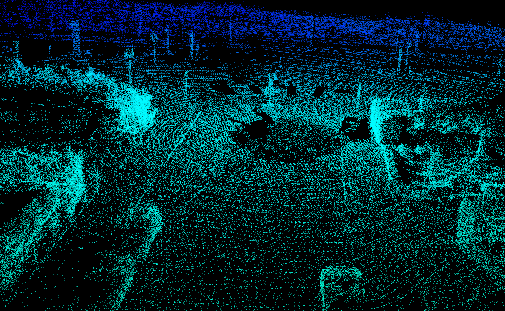
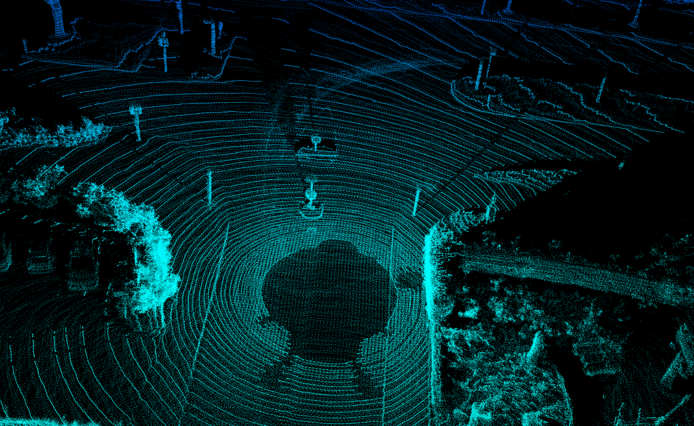

# Dynamic 3D LiDAR SLAM: A Systematic Failure Analysis

[](https://docs.ros.org/en/humble/)
[](https://www.docker.com/)
[](https://www.cvlibs.net/datasets/kitti/)
---
# 0. Execution Guide

Based on the repository structure (`workspace/src/lab_test`), all experimental maps can be generated and visualized using the provided launch files and Python scripts. Follow these steps to reproduce the failure analysis:

You can use these commands to build, run, connect to the container, and finally stop it.
```
bash docker/build.bash
bash docker/run.bash
bash docker/into.bash
bash docker/stop.bash
```

**0. Dataset Preparation**
Because raw point cloud and ROS bag files exceed GitHub's file size limits, please download and extract the KITTI raw dataset (Drive 0009) before running the pipeline. Run these commands inside your designated data folder:
```bash
wget [https://s3.eu-central-1.amazonaws.com/avg-kitti/raw_data/2011_09_26_calib.zip](https://s3.eu-central-1.amazonaws.com/avg-kitti/raw_data/2011_09_26_calib.zip)
wget [https://s3.eu-central-1.amazonaws.com/avg-kitti/raw_data/2011_09_26_drive_0009/2011_09_26_drive_0009_sync.zip](https://s3.eu-central-1.amazonaws.com/avg-kitti/raw_data/2011_09_26_drive_0009/2011_09_26_drive_0009_sync.zip)
unzip 2011_09_26_calib.zip
unzip 2011_09_26_drive_0009_sync.zip
```

**1. Convert the raw dataset into the ROS 2 .mcap format.** 

Ensure that the kitti2mcap package archive (download on https://pypi.org/project/kitti2mcap/) is placed in your workspace/bags directory, then run the following Docker command to execute the conversion seamlessly:
```
docker run --rm --network host \
  -v $(pwd)/workspace/bags:/bags \
  python:3.11 bash -c "pip install /bags/kitti2mcap-0.1.1.tar.gz && kitti2mcap --date 2011_09_26 --drive 0009 --kitti-dir /bags/kitti_data --output /bags/kitti_dataset.mcap"
```

**2. Workspace Build & Generate Odometry Baseline (KISS-ICP)**

After preparing the dataset, enter the Docker container, build the ROS 2 workspace, and run the primary odometry engine to generate the raw global map with ghosting artifacts.
```bash
# Enter the Docker container
bash docker/into.bash

# Build the workspace and source the environment
colcon build
source install/setup.bash

# Launch KISS-ICP
ros2 launch lab_test kiss_icp.launch.py
```
Extract the Output Files, open the second terminal, enter the container, get into /workspace/src/lab_test/src then choose 1 of these script to run:
```bash
# Run the map exporter from kiss-icp script
python3 map_exporter.py

# Or run the map exporter script with ERASOR
python3 dynamic_object_removal_map.py

# Or Run the map exporter script with DUFO map
python3 dufo_map.py
```
Open a third terminal, enter the container, and play the .mcap dataset:
```bash
# Run the map exporter script
ros2 bag play /bags/kitti_dataset.mcap --clock
```
Once the bag file finishes playing, terminate the map exporter node (using Ctrl+C) in the second terminal. The system will automatically serialize and save the outputs. You can retrieve the specific evaluation files from your output directory:

**3. Generate RTAB MAP**

Similar to the odometry baseline, you will run the RTAB-Map backend and play the dataset to observe the ray-tracing latency and occupancy memory.
```bash
# Launch RTABMAP
ros2 launch lab_test rtabmap_backend.launch.py
```
Open the second terminal, enter the container, and run KISS-ICP for publish_odom_tf:
```bash
# Launch KISS-ICP
ros2 launch lab_test kiss_icp.launch.py
```
Open a third terminal, enter the container, and play the .mcap dataset:
```bash
# Run the map exporter script
ros2 bag play /bags/kitti_dataset.mcap --clock
```
Open a fourth terminal, access rtabmap-database to download the map:
```bash
# Access rtabmap database, chooose File, Export 3d map and remember to untick the RGB option
rtabmap-databaseViewer ~/.ros/rtabmap.db
```

**4. Viewing the result maps**

All maps will be saved in workspace/results/latest, to view the map, simply use the pcl_viewer tool:
```bash
pcl_viewer <path_to_your_file>.pcd
```
---

## 1. Executive Summary & Research Motivation

Standard LiDAR-based Simultaneous Localization and Mapping (SLAM) systems rely heavily on the **static-world assumption**: sensor measurements are assumed to originate from rigid, non-moving surfaces. While effective in controlled scenarios, deploying autonomous robots into dynamic urban environments violates this fundamental assumption, leading to acute failure modes across estimation and spatial mapping.

This project investigates the trade-offs and structural failure modes of four distinct LiDAR SLAM and point cloud filtering paradigms:
1. **Odometry-First Registration** (KISS-ICP)
2. **Traditional Ray-Tracing Memory SLAM** (RTAB-Map) 
3. **Space-Partitioning Dynamic Filtering** (ERASOR) 
4. **Ray-Casting Dynamic Awareness** (DUFOMap) 

By reproducing and bench-testing these paradigms on real-world urban data (**KITTI raw sequence `2011_09_26_drive_0009`**), we experimentally validate the inherent limitations of each approach, providing a robust empirical foundation for analyzing mapping degradation.

---

## 2. Theoretical Foundations & Selected Literature

### 2.1. KISS-ICP (Odometry-First)
- **Reference**: *Vizzo, J., et al. "KISS-ICP: In Defense of Point-to-Point ICP – Simple, Accurate, and Robust Registration If Done the Right Way." IEEE Robotics and Automation Letters (RA-L), 2023.*
- **Mechanism**: While technically a pure LiDAR Odometry (LO) pipeline rather than a full SLAM system with loop closure, it provides state-of-the-art pose estimation. We utilize it here to construct a "raw" point cloud map by directly accumulating scans based on its precise odometry.
- **Structural Trade-off**: Maximizes trajectory estimation accuracy and speed at the total expense of map cleanliness; dynamic points are permanently registered.

### 2.2. RTAB-Map (The Established Baseline)
- **Reference**: *Labbé, M., and Michaud, F. "RTAB-Map as an Open-Source Lidar and Visual SLAM Library for Large-Scale and Long-Term Online Operation." Journal of Field Robotics (JFR), 2019.*
- **Mechanism**: Serves as the classic baseline for memory-managed graph SLAM. It incorporates Bresenham 3D ray-tracing across continuous occupancy grids to clear empty space traversed by LiDAR beams.
- **Structural Trade-off**: Preserves exact geometry, but probabilistic occupancy updates require repeated sensor observations, causing significant temporal latency.

### 2.3. ERASOR (Space-Partitioning SOTA)
- **Reference**: *Lim, H., et al. "ERASOR: Egocentric Ratio of Pseudo Occupancy-based Dynamic Object Removal for Static 3D Point Cloud Map Building." IEEE Robotics and Automation Letters (RA-L), 2021.*
- **Mechanism**: Discretizes 3D space egocentrically into Pseudo-Occupancy bins. Bins exhibiting excessive vertical discrepancy ($z$-axis elevation variance) between scans are discarded.
- **Structural Trade-off**: Extremely fast GPU-free removal; however, coarse vertical binning discards co-linear occluded static structures, inducing map perforation.

### 2.4. DUFOMap (Ray-Casting SOTA)
- **Reference**: *Duberg, D., et al. "DUFOMap: Efficient Dynamic Awareness Mapping." IEEE Robotics and Automation Letters (RA-L), 2024.*
- **Mechanism**: Represents the 2024 state-of-the-art in volumetric ray-casting. It builds an efficient dynamic awareness map by rigorously tracing LiDAR beams through a global voxel grid.
- **Structural Trade-off**: Preserves geometry in the near-field. However, diverging LiDAR beams limit effectiveness at long ranges, and continuous ray-casting is computationally intensive.

---

## 3. Experimental Failure Analysis & Empirical Evidence

All experiments were executed inside a standardized ROS 2 Humble Docker environment processing synchronized LiDAR packets from KITTI drive `0009`.

| Paradigm | Methodology | Primary Failure Mode | System Downstream Impact |
| :--- | :--- | :--- | :--- |
| **Odometry-First** | KISS-ICP | Ghosting Trails | Lethal Obstacle Hallucination (Nav2) |
| **Baseline Ray-Tracing** | RTAB-Map | Temporal Latency | Stale Obstacle Phantom Latency |
| **Space-Partitioning** | ERASOR | Over-Rejection (Map Holes) | Frontier Drift & Feature Degeneration |
| **SOTA Ray-Casting** | DUFOMap | Long-Range Sparsity Ghosting | Computation Bottlenecks & Distant Artifacts |

---

### 3.1. Experiment A: Odometry-Focused Registration (KISS-ICP)
- **Observed Phenomenon**: **The "Ghosting" Artifact**


*Figure 1: KISS-ICP global point cloud map in KITTI drive 0009. Dense trails persist along the trajectory of moving vehicles.*

**Technical Root Cause & Navigation Impact:**
KISS-ICP optimizes trajectory by aligning against the static majority of points. Consequently, moving vehicles are permanently merged into the global voxel map as elongated "shadows". In downstream 2D Costmaps, these residual trails act as impenetrable virtual walls, forcing autonomous planners to trigger emergency stops. Because pure odometry systems (and even full SLAM systems lacking a dynamic mapping backend) only accumulate points based on poses, moving vehicles are permanently merged into the global map.

---

### 3.2. Experiment B: Classic Memory-Based Ray-Tracing (RTAB-Map)
- **Observed Phenomenon**: **Temporal Latency & "Stop-and-Go" Lag**


*Figure 2: RTAB-Map 3D visualization. Semi-static obstacles remain in occupancy memory after physical displacement due to ray-tracing clearing latency.*

**Technical Root Cause & Navigation Impact:**
Ray-tracing uses recursive log-odds to update occupancy. A stopped vehicle accumulates massive occupancy probability. When it moves, a single LiDAR sweep cannot immediately revert the probability to "Free". This latency creates a "phantom obstacle" causing unnatural stop-and-go delays for following autonomous vehicles.

---

### 3.3. Experiment C: Space-Partitioning Filtering (ERASOR)
- **Observed Phenomenon**: **Over-Rejection & "Map Holes"**


*Figure 3: ERASOR offline benchmark output. Green: preserved static map. Missing/dark regions: over-rejection on static building facades.*

**Technical Root Cause & Navigation Impact:**
When a moving vehicle passes between the LiDAR and a static background structure, both fall into identical azimuthal-radial bins. ERASOR purges the entire spatial column, perforating static walls and destroying planar constraints required for long-term relocalization.

---

### 3.4. Experiment D: SOTA Ray-Casting (DUFOMap - 2024)
- **Observed Phenomenon**: **Long-Range Sparsity Ghosting & Computational Bottleneck**


*Figure 4: DUFOMap static map extraction. While near-field objects are effectively cleared, significant "ghost trails" persist in distant regions (top right) due to LiDAR beam divergence.*

**Technical Root Cause & System Impact:**
DUFOMap achieves high geometric fidelity in the near-field. However, because it relies on ray intersections, it suffers from **LiDAR angular sparsity** at long ranges. Diverging beams fail to adequately sample distant dynamic vehicles, leaving artifact trails. Additionally, the massive CPU utilization required for dense ray-casting starves downstream local planners of compute cycles.

## 4. Proposed Research Direction: Spatio-Temporal Inpainting

The empirical failure analysis demonstrates a clear trilemma: odometry-first methods leave ghosts, spatial-partitioning destroys static geometry (Map Holes), and ray-casting suffers from long-range sparsity and critical computational bottlenecks. To break this paradigm, I propose a hybrid architecture: **Spatio-Temporal Inpainting**.

### 4.1. Core Hypothesis
The fundamental premise is to decouple dynamic object *detection* from static map *maintenance*:
1. **High-Speed Invalidation Masking:** Utilize a lightweight space-partitioning algorithm (e.g., ERASOR's Pseudo-Occupancy) purely to generate a dynamic bounding mask. Because it purges entire vertical columns, it successfully removes dynamic objects at any distance, bypassing the LiDAR angular sparsity problem seen in DUFOMap.
2. **Historical Geometry Inpainting:** Instead of leaving the resulting "Map Holes" empty, the system queries a topologically managed pose-graph (Long-term Memory). By retrieving historical LiDAR frames where the currently occluded volume was explicitly observed, the system geometrically transforms ($\mathrm{SE}(3)$) and *inpaints* the missing static points back into the current local costmap.

### 4.2. Conceptual Architecture Pipeline

```mermaid
graph TD
    %% Sensor Input
    LIDAR[Raw 3D LiDAR Point Cloud] --> KISS[Odometry Engine: KISS-ICP]
    LIDAR --> ERASOR[Spatial Masking: ERASOR]

    %% Odometry & Transformations
    KISS -- "High-Frequency 6-DOF TFs" --> PG[Topological Pose Graph]
    LIDAR --> PG

    %% Fast Dynamic Removal
    ERASOR -- "Fast Spatial Classification" --> HOLES[Perforated Map\n'Map Holes' Detected]
    ERASOR -- "Occlusion Bounds" --> MASK[Dynamic Void Mask]

    %% Inpainting Engine
    subgraph ST_INPAINT [Spatio-Temporal Inpainting Module]
        MASK --> QUERY[Historical Spatial Query]
        PG -. "Retrieve High-Confidence\nPast Static Scans" .-> QUERY
        QUERY --> TRANS[SE3 Frame Alignment]
    end

    %% Reintegration
    HOLES --> TRANS
    TRANS --> FINAL[Dense, Non-Perforated Static 3D Map]

    %% Downstream Stack
    FINAL --> NAV2[Downstream: Nav2 / Active Exploration]

    classDef highlight fill:transparent,stroke:#0288d1,stroke-width:2px,stroke-dasharray: 5 5,color:#0288d1;
    class ST_INPAINT highlight;
